# AgroRadar

AgroRadar is a mobile app prototype we built for the NASA Space Apps Challenge to help small farmers in Bangladesh plan what to grow. The farmer marks their land on a satellite map, and the app works out which of Bangladesh's 30 agro-ecological zones it falls in. It then suggests a four-year crop rotation for four fields across the three seasons, Rabi, Kharif-1 and Kharif-2, including mixed and relay crops. If the farmer wants to know why a crop was chosen, they can ask the app in Bangla or English, by typing, speaking or sending a photo.

This repository contains a browser-based app prototype, an animated methodology walkthrough and supporting images. The multi-agent pipeline below describes the proposed system; trained forecasting models and an offline LLM are planned components.

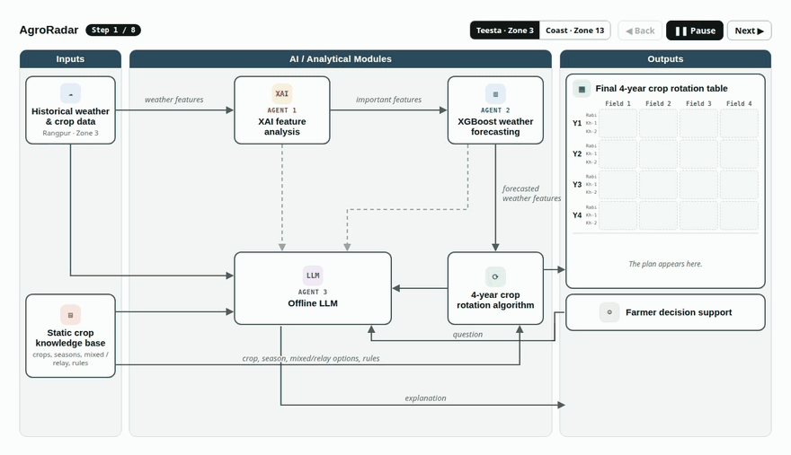

## Contents
1. [The problem](#1-the-problem)
2. [Background](#2-background)
3. [Methodology](#3-methodology)
4. [Methodology workflow](#4-methodology-workflow)
5. [Crop knowledge base](#5-crop-knowledge-base)
6. [Data used](#6-data-used)
7. [The app](#7-the-app)
8. [Files](#8-files)
9. [Next Steps](#9-next-steps)

## 1. The problem

Agriculture still employs 44% of Bangladesh's workforce, more than 35 million people. Farms keep getting smaller: the average was 2.8 acres in 1974 and is about 1.29 acres today. A typical smallholder earns around Tk 2,800 (about USD 24) a month.

The same regions are hit by the same problems every year:
- On the coast, in places like Khulna and Satkhira, salinity now affects about 1.16 million hectares, 39% more than in 1973.
- Along the Teesta, an upstream barrage takes most of the dry-season water, so the land dries out. Then monsoon releases flood the same villages.
- In the east, the 2024 floods damaged about 297,000 hectares of cropland.

The tools farmers have today don't really help with this:
- Government apps mostly give the same fixed advice to everyone, and they are split across several separate platforms.
- Crop recommendation models in research papers can be accurate, but they don't explain their answers. They also need lab soil tests, and they only suggest one crop for one season.
- We couldn't find any system where several AI agents work together to analyse, forecast, plan and explain.
- Almost nothing explains its advice to the farmer, and most tools need a good internet connection.

## 2. Background

### Agro-ecological zones
Bangladesh is divided into 30 agro-ecological zones based on land height, climate, flood depth and soil. A crop that does well in one zone can fail in the next, so every recommendation in AgroRadar starts from the zone.

### Cropping seasons
| Season | Months | Weather | Common crops |
|---|---|---|---|
| Rabi (রবি) | Oct – mid-Mar | Cool and dry, needs irrigation | Boro rice, wheat, mustard, potato, lentil |
| Kharif-1 (খরিপ-১) | mid-Mar – mid-Jun | Hot, storms, hail, flash floods | Jute, Aus rice, maize, sesame, mung bean |
| Kharif-2 (খরিপ-২) | mid-Jun – mid-Sep | Monsoon, heavy rain, floods | Transplanted Aman rice |

### Mixed cropping, relay cropping and crop rotation
- **Mixed cropping:** two crops grow in the same field at the same time, like mustard with lentil, or maize with mung bean. Their roots take food from different depths, and if one crop does badly the farmer still has the other.
- **Relay cropping:** the next crop is sown before the current one is harvested, like khesari or lentil sown into Aman rice. This saves time, labour and irrigation water, and the new crop uses the moisture left in the soil.
- **Crop rotation:** the land is split into four plots, and each cropping pattern moves to the next plot every year. After four years the cycle starts again. Including pulses puts nitrogen back into the soil, so farmers need less fertilizer, and pests don't get a chance to build up.

## 3. Methodology

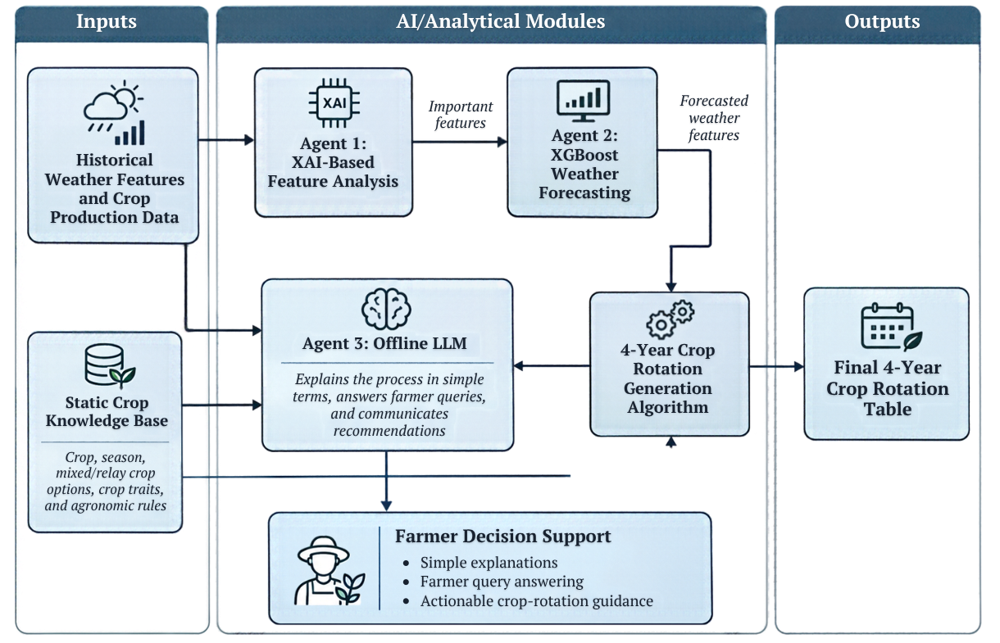

| Part | What goes in | What it does | What comes out |
|---|---|---|---|
| Historical weather and crop data | NASA POWER data for each zone, district crop production | Raw input | 22+ weather and soil features per season |
| Agent 1: XAI feature analysis | All features and yield | Finds which features actually affect yield, and why | The 9 most important features |
| Agent 2: XGBoost forecasting | The important features | Forecasts the next agricultural year | Forecasts for Rabi, Kharif-1 and Kharif-2 |
| Crop knowledge base | EcoCrop, SPAS, AgriclimateBD, BARC fertilizer guide, AEZ map | Stores crop calendars, needs, fertilizer rates, tolerance limits and crop pairs | Rules and candidate crops |
| Rotation algorithm | Forecast, knowledge base, zone and soil | Checks sowing time, drainage, crop family, nutrients and weather risk, then places each pattern once per field per year | A 4 field × 4 year × 3 season plan, with mixed and relay options |
| Agent 3: offline LLM | Everything above | Explains the plan and answers the farmer's questions, without internet | Simple answers, each linked to where the information came from |

## 4. Methodology workflow

[`Prototype/methodology_flow.html`](Prototype/methodology_flow.html) shows the same pipeline as an animation. Open it in a browser and use Back, Play/Pause and Next, or the arrow keys. The buttons at the top switch between the Teesta zone (Zone 3) and the coastal zone (Zone 13).

| Step | What happens |
|---|---|
| 1 | 22 weather features leave the input |
| 2 | Agent 1 keeps 9 important features and drops the other 13 |
| 3 | Agent 2 forecasts rain for Rabi, Kharif-1 and Kharif-2 |
| 4 | The rotation algorithm combines the forecast with crop rules and fills the 4×4 table |
| 5 | Mixed and relay crops are added from the knowledge base |
| 6 | The farmer asks a question, and it goes to Agent 3 |
| 7 | Agent 3 collects the key facts from every part of the pipeline |
| 8 | Agent 3 answers using the problems of the farmer's zone |

The rotation plan for a farm in the Teesta zone:

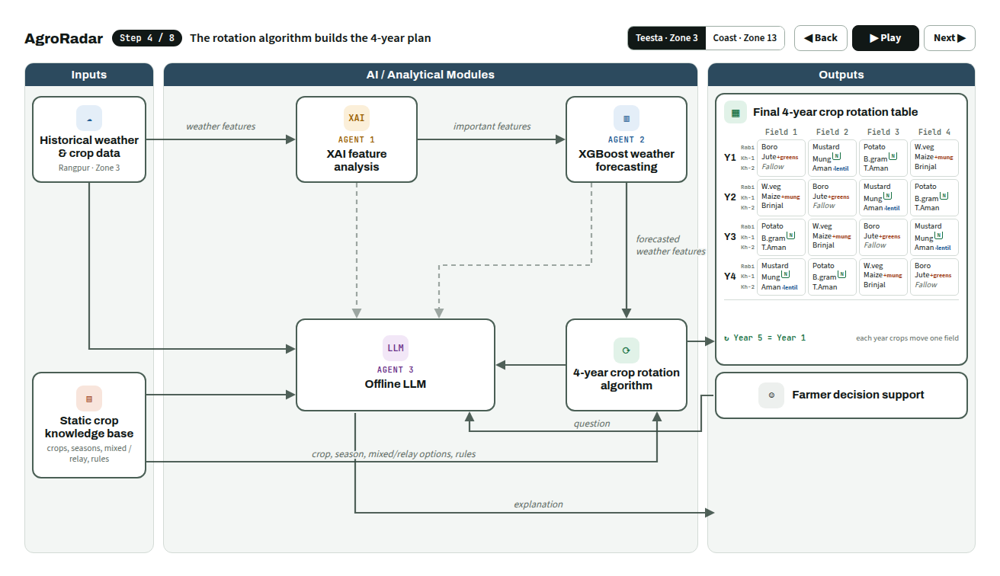

Agent 3's answer for the Teesta zone:

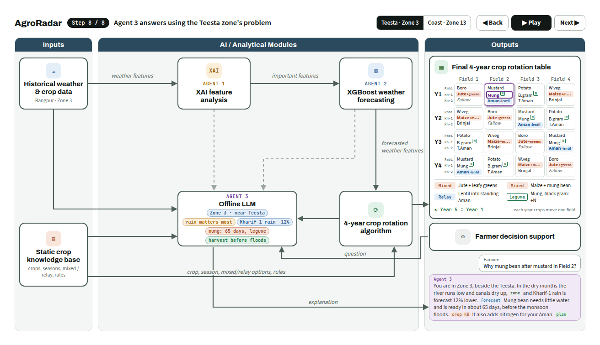

> "You are in Zone 3, beside the Teesta. In the dry months the river runs low and canals dry up, and Kharif-1 rain is forecast 12% lower. Mung bean needs little water and is ready in about 65 days, before the monsoon floods. It also adds nitrogen for your Aman."

Agent 3's answer for the coastal zone:

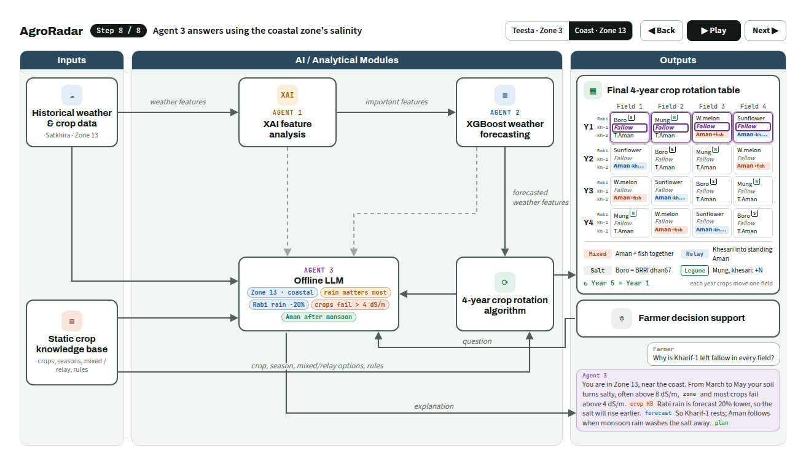

> "You are in Zone 13, near the coast. From March to May your soil turns salty, often above 8 dS/m, and most crops fail above 4 dS/m. Rabi rain is forecast 20% lower, so the salt will rise earlier. So Kharif-1 rests; Aman follows when monsoon rain washes the salt away."

## 5. Crop knowledge base

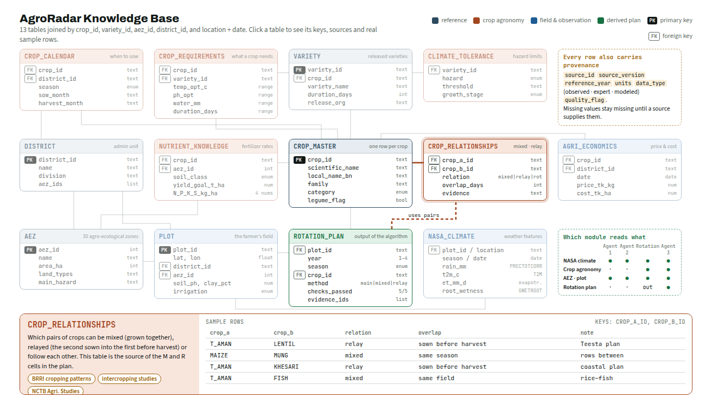

The proposed knowledge base has 13 tables, built around `CROP_MASTER`. The diagram above shows the schema; an interactive schema viewer is not included in this repository.

- Reference: `CROP_MASTER`, `VARIETY`, `AEZ`, `DISTRICT`
- Crop agronomy: `CROP_CALENDAR`, `CROP_REQUIREMENTS`, `NUTRIENT_KNOWLEDGE`, `CLIMATE_TOLERANCE`, `CROP_RELATIONSHIPS`
- Field and observations: `PLOT`, `NASA_CLIMATE`, `AGRI_ECONOMICS`
- Output: `ROTATION_PLAN`

The tables join on `crop_id`, `variety_id`, `aez_id`, `district_id`, and location plus date. Every row also records where it came from (`source_id`, `source_version`, `reference_year`, `units`, `data_type`, `quality_flag`).

## 6. Data used

### NASA data
| Dataset | Link | How we used it |
|---|---|---|
| NASA POWER, Agroclimatology, daily, one point per zone | https://power.larc.nasa.gov/data-access-viewer/ | Weather and soil features for each zone. Agent 1 ranks them, Agent 2 forecasts them, and the app shows them |
| NASA GIBS (Blue Marble, Landsat) | https://nasa-gibs.github.io/gibs-api-docs/ | Satellite map, and zooming in to the farmer's field |

From NASA POWER we downloaded:
- **Solar:** all-sky, clear-sky, direct normal, diffuse and top-of-atmosphere shortwave irradiance; all-sky and clear-sky PAR; UVA, UVB, UV index
- **Temperature:** T2M (mean, max, min, range), dew/frost point, wet bulb temperature, earth skin temperature, longwave downward irradiance
- **Humidity and rain:** specific humidity, relative humidity, precipitation, precipitation (IMERG), precipitable water
- **Wind and pressure:** surface pressure; wind speed (mean, max, min, range) and wind direction at 2 m and 10 m
- **Soil:** surface soil wetness (0–5 cm), root zone soil wetness (0–100 cm), profile soil moisture

### Other datasets
| Dataset | How we used it |
|---|---|
| FAO EcoCrop | Temperature, pH, rainfall, growing period and salt tolerance for each crop |
| ISRIC SoilGrids | Soil pH, nitrogen, organic carbon and texture for each field |
| AgriclimateBD | Crop production with weather by district and season, used to rank features against yield |
| SPAS-Dataset-BD | Sowing and harvest months by district |
| BARC Fertilizer Recommendation Guide 2024 | Fertilizer rates by crop and soil, and land and soil details for each zone |
| BARC AEZ boundaries | The map of the 30 zones |
| NCTB Agriculture Studies, Class 7 and 8 | Crop rotation, mixed and relay cropping rules and examples |

## 7. The app

Open [`Prototype/index.html`](Prototype/index.html) in a browser to explore the app prototype. No build step is required. An internet connection is needed to load external libraries, fonts, map tiles and live data requests.

The screenshots below show the prototype interface. Forecasts, alerts and photo replies include example values, as described in [Next Steps](#9-next-steps).

| | | |
|---|---|---|
| 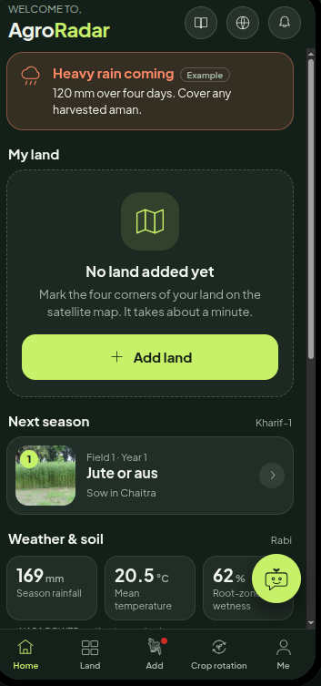 | 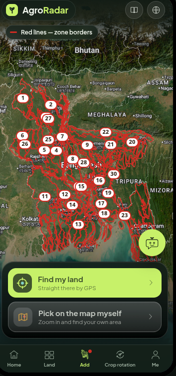 | 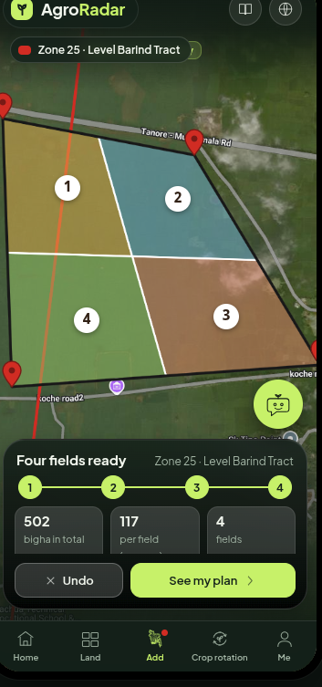 |
| Home: weather alerts, saved land, next season's crop | Map of the 30 zones; "Find my land" uses GPS | The farmer marks the land, which is split into four fields |
| 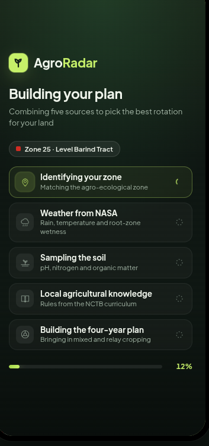 | 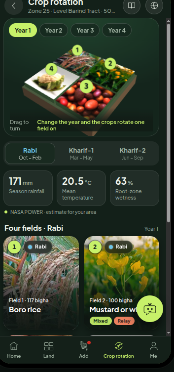 | 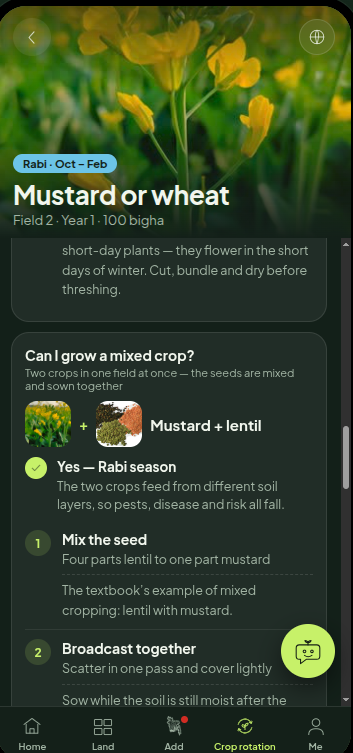 |
| The plan is built from zone, weather, soil and local knowledge | Four-year rotation; change the year or season to see the crops move | Mixed crop suggestion, e.g. mustard with lentil |
| 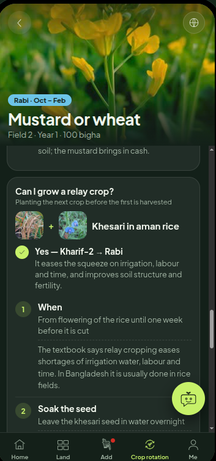 | 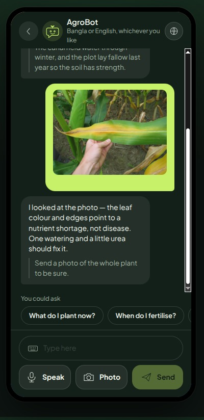 | |
| Relay crop suggestion, e.g. khesari in Aman | AgroBot answers questions and looks at crop photos | |

## 8. Files

```text
AgroRadar/
├── README.md
├── Prototype/
│   ├── index.html
│   └── methodology_flow.html
└── Assets/
    ├── methodology_flow.gif
    ├── methodology.png
    ├── flow_rotation_plan.png
    ├── flow_teesta_answer.png
    ├── flow_coast_answer.png
    ├── knowledge_base_schema.png
    └── app_*.png
```

## 9. Next Steps

Future Works:

1. Validate XAI and XGBoost agents on several years of NASA POWER data for all 30 zones.
2. Fill in the knowledge base with BRRI regional cropping patterns and BARC crop zoning data.
3. Add market prices so plans can be compared on profit too.
4. Test the app with farmers in the Teesta and coastal zones, and measure usability with the System Usability Scale.
5. Connect it with the government's Krishak Smart Card.
